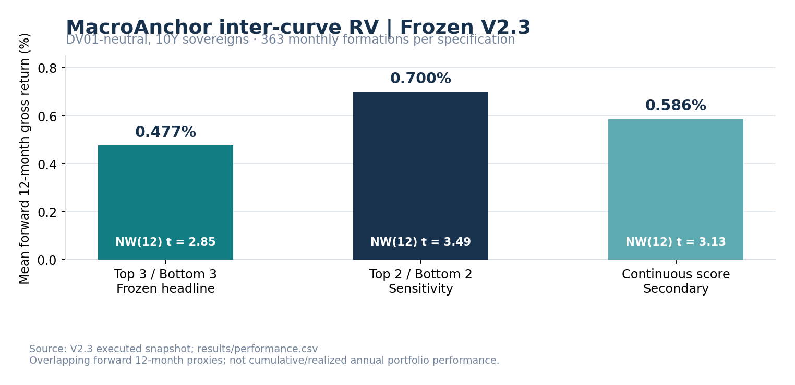
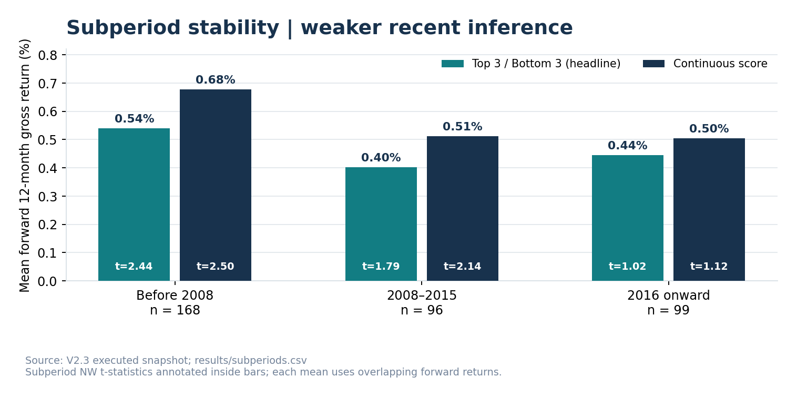
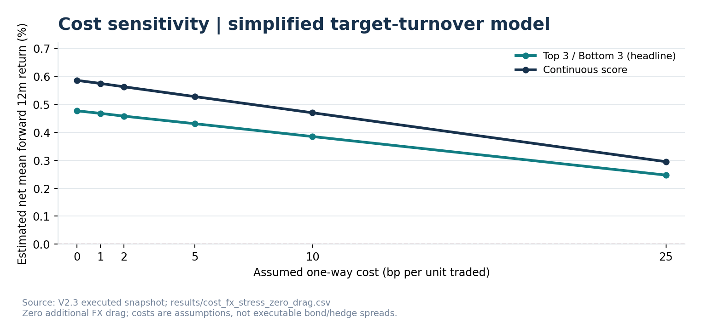
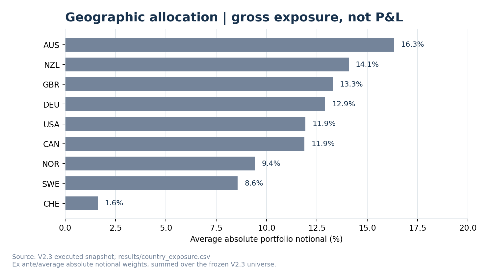
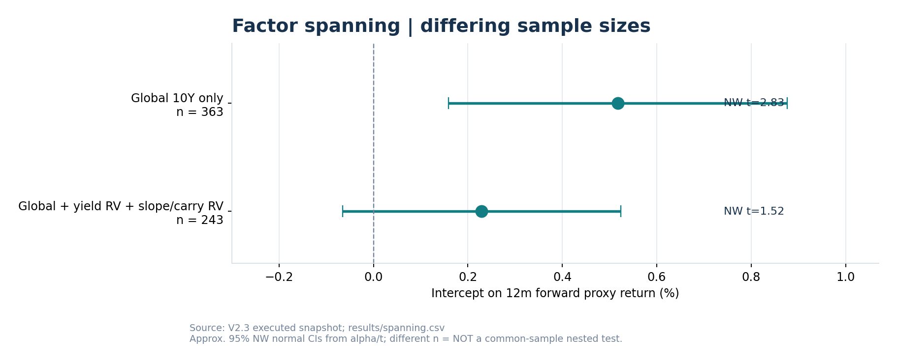

# MacroAnchor · Inter-Curve Relative Value

**Cross-country sovereign rates research, extending [MacroAnchor bond risk premia](https://github.com/svr-L/macroanchor-bond-risk-premia).**

[Parent model & Repo](https://github.com/svr-L/macroanchor-bond-risk-premia) · [Separate intra-curve RV project](https://github.com/svr-L/macroanchor-curve-relative-value)

**Research classification:** historical **12-month forward proxy-return backtest** · **V2.3 core frozen** · **CDS and Q-credit extensions exploratory** · **not executable performance**.

## From macro-finance model to sovereign relative value

The **parent model** treats a moving macroeconomic anchor, `r* + trend inflation`, as the *central tendency of a physical-measure short-rate process*, **not** a mechanically fair value for 10Y bond yields. It constructs a model-implied **pure-expectations yield**; the difference from the observed sovereign yield is a macro-anchored term-premium residual.

**This repository evolves that pre-existing signal into an inter-curve trading research question:** when sovereign curves are compared at the **same 10Y maturity**, does ranking countries by their *past-only standardized* MacroAnchor residual support **DV01-neutral** long/short relative value? This is **between national yield curves**, not a butterfly/tenor trade on one curve.

The **separate** [`macroanchor-curve-relative-value`](https://github.com/svr-L/macroanchor-curve-relative-value) studies **intra-curve / cross-tenor** RV. The two projects do not share a portfolio-construction outcome or independent alpha claim. See [research lineage](docs/paper_lineage.md).

## Core V2.3: frozen 10Y cross-country test

- **Formation:** monthly; original usable panel spans **9 sovereign countries**, with 363 usable headline formation months.
- **Signal:** unchanged parent-model `tp_z_past`, country-normalized from *past* information only.
- **Headline construction:** long the three highest scores, short the three lowest, with equal signed DV01 targets within each side; duration converts DV01 targets to notionals; gross absolute notional sums to 1; **signed net DV01 = 0**, net cash notional may differ from zero.
- **Outcome:** approximated **12-month local-currency sovereign bond excess return** using 10Y yield moves/duration and 3M domestic funding. Forward 12-month returns overlap; inference uses Newey–West lag 12 and twelve calendar tracks.
- **Pre-specified comparisons:** top-2/bottom-2 sensitivity, continuous-score implementation; global 10Y duration plus identically constructed simple yield-level and slope/carry RV factors.

| V2.3 specification | Mean forward 12m gross excess return | NW(12) t | Months | 12 month-offset tracks positive |
|---|---:|---:|---:|---:|
| **Top 3 / bottom 3 (headline)** | **0.477%** | **2.85** | **363** | **12/12** |
| Top 2 / bottom 2 (sensitivity) | 0.700% | 3.49 | 363 | 12/12 |
| Continuous score | 0.586% | 3.13 | 363 | 12/12 |



**Interpretation:** mean **overlapping forward 12-month** returns, *not* annualized realized portfolio P&L, and twelve offset tracks are **not twelve independent validations**. The more concentrated top-2 sensitivity is **not** a newly selected headline.

## Robustness, concentration and transaction costs



The subperiod results remain positive descriptively, but the NW statistic weakens substantially in later samples. See [source table](results/subperiods.csv). No sample was tuned to maximize the statistic.



These are **model-based one-way turnover-cost assumptions** with **zero extra FX drag**, *not* market quotes or measured executable FX-hedged returns. Headline breakeven is approximately **51.8 bp per one-way unit traded** under this proxy convention; it must not be interpreted as institutional capacity.

<details><summary>Additional diagnostics: country concentration and factor spanning</summary>



Country chart measures average **absolute notional exposure**, not return attribution.



For the headline, global-duration-only alpha is **0.518%** (NW t **2.83**, n **363**). With additional yield-level and slope/carry RV controls the alpha is **0.229%** (NW t **1.52**, n **243**). **These are different samples, so the alpha/t-stat change is not attributable exclusively to added factors; the full-spanning alpha is not significant at 5%.**

</details>

## Code, evidence and provenance

```text
notebooks/01_macroanchor_g10_10y_rv_v2_3_frozen.ipynb   # original frozen code: first cell uploads input
results/*.csv                                         # measured V2.3 aggregate outputs
results/manifest.json                                 # source hashes + sample provenance
evidence/v2_3_executed_snapshot.ipynb                  # actual executed original run
figures/*.png                                         # plots from results CSVs, not simulated curves
scripts/plot_results.py                               # regenerate plots from CSVs
scripts/verify_manifest.py                            # verify result manifest
exploratory/notebooks/02_credit_buckets_v3_2_exploratory.ipynb
exploratory/notebooks/03_q_credit_pricing_v4_1_exploratory.ipynb
exploratory/README.md                                 # guardrails; no promoted extension alpha
docs/paper_lineage.md                                  # connection to parent paper
```

**Reproducing the headline:** open the frozen notebook in **Google Colab** and press **Run all**. Its **first executable cell immediately requests the dataset upload**. Supply `g10_panel_model_objects.csv` with verified SHA-256:

`1628c4eaff487f6d87cc93fe62c7af909850d9ceedf448d9d8321f8b8477bbf6`

The **private historical model panel is intentionally not redistributed**; re-creating a new panel from public FRED/OECD macro vintages may yield different results. With the provided original dataset, no additional user prompts are needed after the first upload. Audit [methodology](docs/methodology_and_limits.md), [status](docs/research_status.md) and [figure provenance](docs/figure_provenance.md) before claiming replication.

To reproduce the figures *without* the model panel:

```bash
python -m pip install -r requirements.txt
python scripts/plot_results.py
python -m unittest discover -s tests -v
python scripts/verify_manifest.py
```

## Important caveats

- **Not institutional bond/IRS/futures P&L:** 12-month duration-approximated **local-currency** excess-return proxies omit coupon schedules, historical FX forwards, basis, funding execution, taxes, trading frictions and default/rating-specific hedge costs.
- **Not credit-neutral:** zero aggregate 10Y DV01 does not eliminate sovereign CDS, FX, safe-haven, country funding, liquidity, convexity or nonparallel factor risks.
- **No independent re-validation claim:** the parent predictor has historical research and selection history; a frozen *portfolio rule* does not make the source alpha fully independent or publication-grade by itself.
- **Spanning sample changes:** global-only n=363 versus full controls n=243; robust nested comparison on a common sample remains future work.
- **No manufactured capital curve:** overlapping forward 12-month outcomes cannot be cumulated into a deployable portfolio wealth index.

**Licensing:** no new license is asserted for this packaged repo. See [`NOTICE_LICENSE.md`](NOTICE_LICENSE.md) and choose an explicit license before redistribution.
